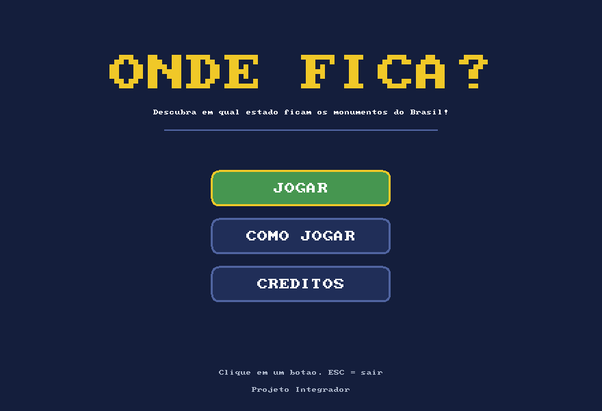
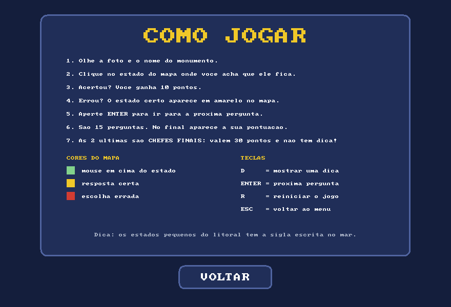
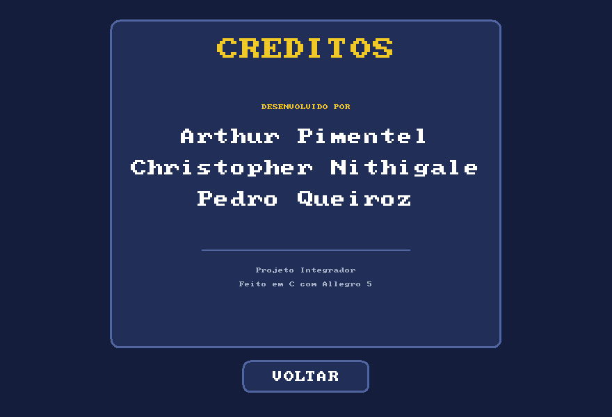
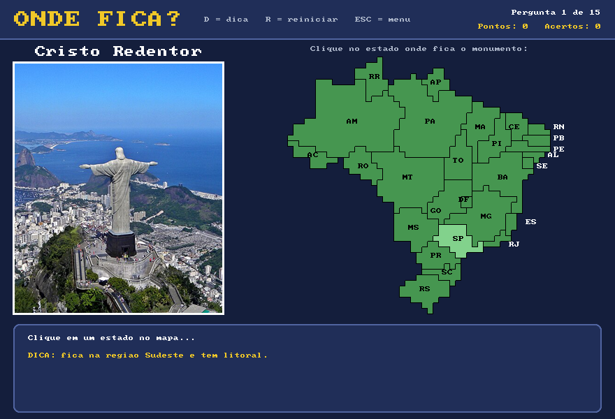
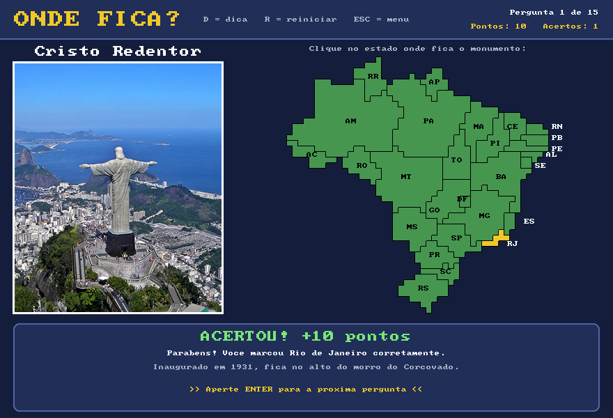
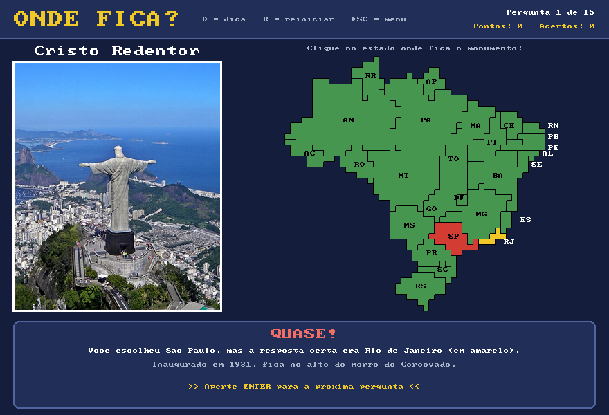
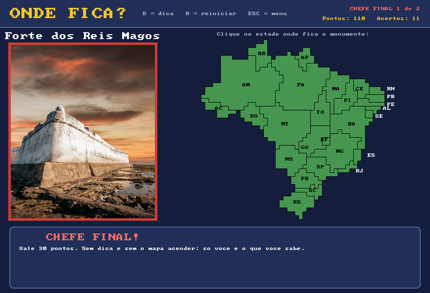
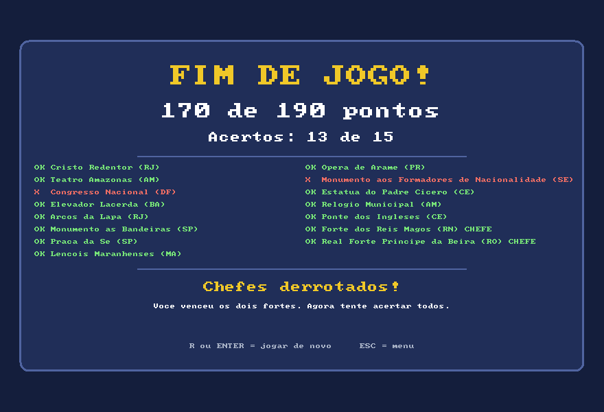

# PAC-Adventure — Onde Fica?

Projeto Integrador. Jogo educacional feito em **C** com **Allegro 5** no **Visual Studio**.

O jogo mostra um monumento famoso do Brasil e um mapa. O jogador clica no estado onde acredita que o monumento fica. O conteúdo trabalha localização dos estados, regiões brasileiras e patrimônio cultural.

## Telas do jogo

**Tela de entrada** — botões para jogar, ver como jogar e ver os créditos.

**Como jogar** — passo a passo, cores do mapa e teclas.

**Créditos** — nomes da equipe.

**Pergunta com dica** — o estado embaixo do mouse fica verde-claro e a tecla `D` mostra a dica.

**Acerto** — o estado certo fica em amarelo, o jogador ganha 10 pontos e aparece uma curiosidade.

**Erro** — a escolha errada fica em vermelho e o estado certo em amarelo.

**Chefe final** — as duas últimas perguntas valem 30 pontos, não têm dica e o mapa não acende com o mouse.

**Tela final** — pontuação, acertos e o resultado das 15 perguntas em duas colunas.

## Perguntas

O jogo tem **15 perguntas**, uma para cada monumento. As duas últimas são os **chefes finais**:

| # | Monumento | Estado (resposta) | Região |
|---|---|---|---|
| 1 | Cristo Redentor | Rio de Janeiro (RJ) | Sudeste |
| 2 | Teatro Amazonas | Amazonas (AM) | Norte |
| 3 | Congresso Nacional | Distrito Federal (DF) | Centro-Oeste |
| 4 | Elevador Lacerda | Bahia (BA) | Nordeste |
| 5 | Arcos da Lapa | Rio de Janeiro (RJ) | Sudeste |
| 6 | Monumento às Bandeiras | São Paulo (SP) | Sudeste |
| 7 | Praça da Sé | São Paulo (SP) | Sudeste |
| 8 | Lençóis Maranhenses | Maranhão (MA) | Nordeste |
| 9 | Ópera de Arame | Paraná (PR) | Sul |
| 10 | Monumento aos Formadores de Nacionalidade | Sergipe (SE) | Nordeste |
| 11 | Estátua do Padre Cícero | Ceará (CE) | Nordeste |
| 12 | Relógio Municipal (Manaus) | Amazonas (AM) | Norte |
| 13 | Ponte dos Ingleses (Fortaleza) | Ceará (CE) | Nordeste |
| 14 | **Chefe final 1:** Forte dos Reis Magos | Rio Grande do Norte (RN) | Nordeste |
| 15 | **Chefe final 2:** Real Forte Príncipe da Beira | Rondônia (RO) | Norte |

## Funcionalidades

- **Tela de entrada** com os botões **Jogar**, **Como jogar** e **Créditos**. O botão embaixo do mouse fica verde.
- **Quinze perguntas em sequência**, com a foto e o nome de cada monumento.
- **Chefes finais:** as 2 últimas perguntas valem **30 pontos**, não têm dica, o mapa não acende com o mouse e a foto ganha moldura vermelha.
- **Pontuação:** cada acerto vale **10 pontos** e cada chefe vale 30 (máximo de 190). O placar aparece no canto superior direito.
- **Mensagens de acerto e erro:** ao acertar aparece "ACERTOU! +10 pontos"; ao errar aparece qual era a resposta certa. Nos dois casos o jogo mostra uma curiosidade sobre o monumento.
- **Dica:** a tecla `D` mostra uma dica diferente para cada pergunta.
- **Destaque do mouse:** o estado embaixo do mouse fica verde-claro antes do clique.
- **Cores no mapa depois da resposta:** o estado certo fica em **amarelo** e uma escolha errada fica em **vermelho**.
- **Tela final:** mostra a pontuação, a quantidade de acertos, o resultado de cada pergunta e uma mensagem de acordo com o desempenho.
- **Reiniciar:** na tela final, `R` ou `Enter` começam um jogo novo do zero.

## Controles

| Ação | Tecla / mouse |
|---|---|
| Escolher um botão do menu | Clique com o botão esquerdo |
| Escolher um estado | Clique com o botão esquerdo no mapa |
| Mostrar dica | `D` |
| Próxima pergunta (depois de responder) | `Enter` |
| Reiniciar o jogo (volta à pergunta 1 e zera os pontos) | `R` |
| Jogar de novo na tela final | `R` ou `Enter` |
| Voltar ao menu | `Esc` ou botão **Voltar** |
| Sair (na tela de entrada) | `Esc` |

## Como funciona

- **Vetores das perguntas:** cada pergunta ocupa a mesma posição em vários vetores (`monumentos`, `arquivos`, `respostas`, `dicas`, `curiosidades`). A variável `pergunta` diz qual posição está na tela.
- **Mapa do Brasil:** o mapa é uma matriz de letras no código, em que cada letra é um estado e o `.` é o mar. Cada letra vira um quadradinho na tela, formando o contorno do Brasil com os 26 estados e o Distrito Federal. As fronteiras são simplificadas, e o DF foi um pouco aumentado para dar para clicar.
- **Detecção do clique:** a posição do mouse é dividida pelo tamanho do quadradinho, o que dá a linha e a coluna da matriz. A letra nessa posição diz qual estado foi clicado. Clicar no mar não faz nada.
- **Pontuação:** se o estado clicado for igual à resposta da pergunta, o jogo soma os pontos da pergunta (10, ou 30 nos chefes) em `pontos` e 1 em `acertos`.
- **Fotos:** cada monumento tem um arquivo de imagem na mesma pasta do `main.c`. Se uma foto não for encontrada, o jogo **não fecha**: ele mostra um quadro com o nome do arquivo que falta.

O site do projeto fica na pasta `docs/` e pode ser publicado pelo GitHub Pages. A página `docs/processo.html` mostra o passo a passo da criação, com as versões antigas do jogo tiradas do histórico do Git.

Todo o código está em um único arquivo, `main.c`. A explicação do código está em [`EXPLICACAO.md`](EXPLICACAO.md).

## Como executar

Requisitos: Visual Studio 2022 com a carga de trabalho **Desenvolvimento para desktop com C++**.

1. Clone o repositório e abra `JogoAllegro.sln`.
2. Compile com **F5**. O Visual Studio baixa automaticamente o pacote NuGet do Allegro (listado em `packages.config`).
   - Se não baixar, clique com o botão direito na solução → **Restaurar Pacotes NuGet**.
3. Os addons usados já estão ativados no projeto (**Propriedades → Allegro 5 → Add-ons**): **Font**, **Primitives** e **Image**.

## Fotos dos monumentos

| Arquivo | Monumento | Situação |
|---|---|---|
| `cristo.png` | Cristo Redentor | Incluída no projeto |
| `teatro.png` | Teatro Amazonas | Incluída no projeto |
| `congresso.png` | Congresso Nacional | Incluída no projeto |
| `elevador.png` | Elevador Lacerda | Incluída no projeto |
| `arcos.png` | Arcos da Lapa | Incluída no projeto |
| `bandeiras.png` | Monumento às Bandeiras | Incluída no projeto |
| `se.png` | Praça da Sé | Incluída no projeto |
| `lencois.png` | Lençóis Maranhenses | Incluída no projeto |
| `opera.png` | Ópera de Arame | Incluída no projeto |
| `formadores.png` | Monumento aos Formadores de Nacionalidade | Incluída no projeto |
| `padre_cicero.png` | Estátua do Padre Cícero | Incluída no projeto |
| `relogio.png` | Relógio Municipal de Manaus | Incluída no projeto |
| `ponte_ingleses.png` | Ponte dos Ingleses | Incluída no projeto |
| `reis_magos.png` | Forte dos Reis Magos | Incluída no projeto |
| `principe_beira.png` | Real Forte Príncipe da Beira | Incluída no projeto |

Para adicionar uma foto nova:

1. Baixe uma foto de uso livre (por exemplo, do [Wikimedia Commons](https://commons.wikimedia.org)).
2. Recorte/redimensione para **300 × 360 pixels** (mesmo tamanho do `cristo.png`).
3. Salve como PNG com o nome da tabela acima, na mesma pasta do `main.c`.
4. Para rodar o `.exe` direto (fora do Visual Studio), as fotos precisam estar ao lado do executável.
5. Anote o crédito da foto na seção abaixo.

## Equipe

Desenvolvido por Arthur Pimentel, Christopher Nithigale e Pedro Queiroz.

## Crédito das imagens

Foto do Cristo Redentor: "Christ on Corcovado mountain", de Artyominc, [Wikimedia Commons](https://commons.wikimedia.org/wiki/File:Christ_on_Corcovado_mountain.JPG), licença [CC BY-SA 3.0](https://creativecommons.org/licenses/by-sa/3.0/). A imagem foi recortada.

Foto Teatro Amazonas: "Noite no Teatro Amazonas (cropped)", de Susan Valentim, [Wikimedia Commons](https://commons.wikimedia.org/wiki/File:Noite_no_Teatro_Amazonas_(cropped).jpg), licença [CC BY-SA 4.0](https://creativecommons.org/licenses/by-sa/4.0/). A imagem foi recortada.

Foto Congresso Nacional: "Congresso Nacional BSB 06 2014 8856 cropped", de Mariordo (Mario Roberto Durán Ortiz), [Wikimedia Commons](https://commons.wikimedia.org/wiki/File:Congresso_Nacional_BSB_06_2014_8856_cropped.jpg), licença [CC BY-SA 4.0](https://creativecommons.org/licenses/by-sa/4.0/). A imagem foi recortada.

Foto Elevador Lacerda: "Elevador Lacerda 03", de JLPizzol, [Wikimedia Commons](https://commons.wikimedia.org/wiki/File:Elevador_Lacerda_03.jpg), licença [CC BY-SA 4.0](https://creativecommons.org/licenses/by-sa/4.0/). A imagem foi recortada.

Foto Arcos da Lapa: "At Rio de Janeiro 2019 125", de Mike Peel (www.mikepeel.net), [Wikimedia Commons](https://commons.wikimedia.org/wiki/File:At_Rio_de_Janeiro_2019_125.jpg), licença [CC BY-SA 4.0](https://creativecommons.org/licenses/by-sa/4.0/). A imagem foi recortada.

Foto Monumento às Bandeiras: "Monumento às Bandeiras 01", de Dornicke (Lucas B. Salles), [Wikimedia Commons](https://commons.wikimedia.org/wiki/File:Monumento_%C3%A0s_Bandeiras_01.jpg), domínio público. A imagem foi recortada.

Foto Praça da Sé: "Catedral da Sé em São Paulo", de Wilfredor, [Wikimedia Commons](https://commons.wikimedia.org/wiki/File:Catedral_da_S%C3%A9_em_S%C3%A3o_Paulo.jpg), [CC0](https://creativecommons.org/publicdomain/zero/1.0/) (domínio público). A imagem foi recortada.

Foto Lençóis Maranhenses: "Lençóis Maranhenses 2018", de Julius Dadalti, [Wikimedia Commons](https://commons.wikimedia.org/wiki/File:Len%C3%A7%C3%B3is_Maranhenses_2018.jpg), licença [CC BY-SA 4.0](https://creativecommons.org/licenses/by-sa/4.0/). A imagem foi recortada.

Foto Ópera de Arame: "Ópera de Arame in Curitiba by Domingos Bongestabs 01", de Domingos Bongestabs, [Wikimedia Commons](https://commons.wikimedia.org/wiki/File:%C3%93pera_de_Arame_in_Curitiba_by_Domingos_Bongestabs_01.jpg), licença [CC BY-SA 4.0](https://creativecommons.org/licenses/by-sa/4.0/). A imagem foi recortada.

Foto Monumento aos Formadores de Nacionalidade: "Monumento aos Formadores de Nacionalidade Aracaju Sergipe 2022-6293", de Paul R. Burley, [Wikimedia Commons](https://commons.wikimedia.org/wiki/File:Monumento_aos_Formadores_de_Nacionalidade_Aracaju_Sergipe_2022-6293.jpg), licença [CC BY-SA 4.0](https://creativecommons.org/licenses/by-sa/4.0/). A imagem foi recortada.

Foto Estátua do Padre Cícero: "Estátua do Padre Cícero no Horto, em Juazeiro do Norte", de Allan Patrick, [Wikimedia Commons](https://commons.wikimedia.org/wiki/File:Est%C3%A1tua_do_Padre_C%C3%ADcero_no_Horto,_em_Juazeiro_do_Norte.jpg), licença [CC BY-SA 2.0](https://creativecommons.org/licenses/by-sa/2.0/). A imagem foi recortada.

Foto Relógio Municipal de Manaus: "Relógio Municipal- Manaus 16-04-2015", de JLPizzol, [Wikimedia Commons](https://commons.wikimedia.org/wiki/File:Rel%C3%B3gio_Municipal-_Manaus_16-04-2015.jpg), licença [CC BY-SA 4.0](https://creativecommons.org/licenses/by-sa/4.0/). A imagem foi recortada.

Foto Ponte dos Ingleses: "Ponte dos Ingleses, também conhecida como Ponte Metálica", de Claudney Neves, [Wikimedia Commons](https://commons.wikimedia.org/wiki/File:Ponte_dos_Ingleses,_tamb%C3%A9m_conhecida_como_Ponte_Met%C3%A1lica.jpg), licença [CC BY-SA 4.0](https://creativecommons.org/licenses/by-sa/4.0/). A imagem foi recortada.

Foto Forte dos Reis Magos: "Natal - Forte dos Reis Magos", de DlauriniJr, [Wikimedia Commons](https://commons.wikimedia.org/wiki/File:Natal_-_Forte_dos_Reis_Magos.jpg), licença [CC BY-SA 4.0](https://creativecommons.org/licenses/by-sa/4.0/). A imagem foi recortada.

Foto Real Forte Príncipe da Beira: "Forte Príncipe da Beira", de Israelvalejr, [Wikimedia Commons](https://commons.wikimedia.org/wiki/File:Forte_Pr%C3%ADncipe_da_Beira.jpg), licença [CC BY-SA 4.0](https://creativecommons.org/licenses/by-sa/4.0/). A imagem foi recortada.

## Limites

Quinze perguntas fixas, sempre na mesma ordem, sem sons, animações, ranking ou cronômetro. Os textos na tela estão sem acentos para evitar problemas de codificação com a fonte embutida do Allegro.
